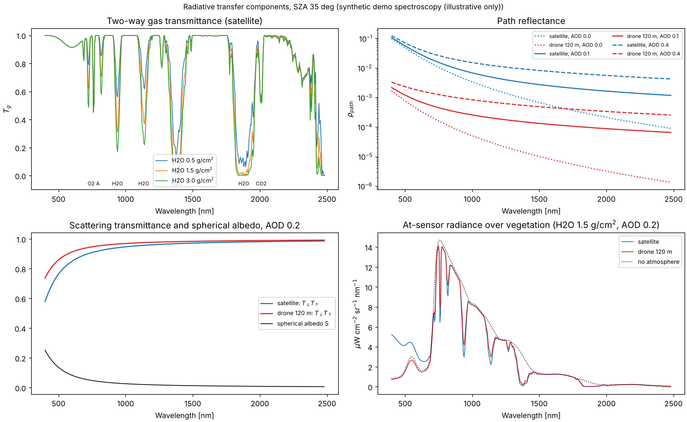
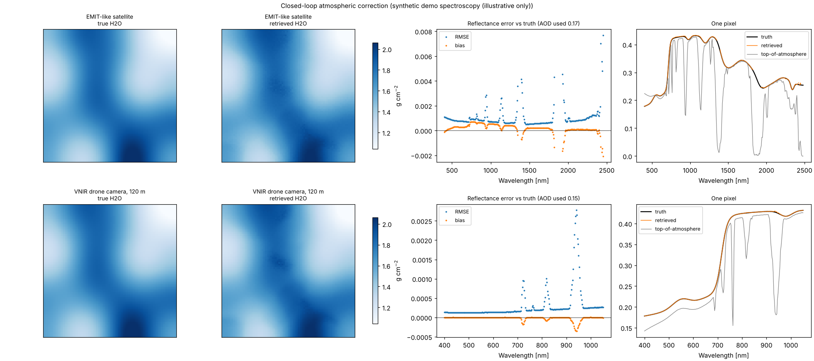
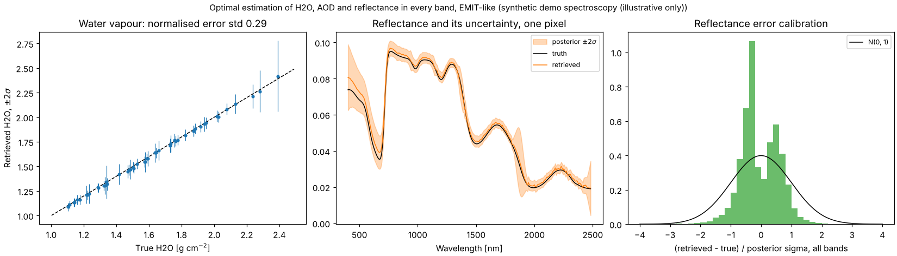
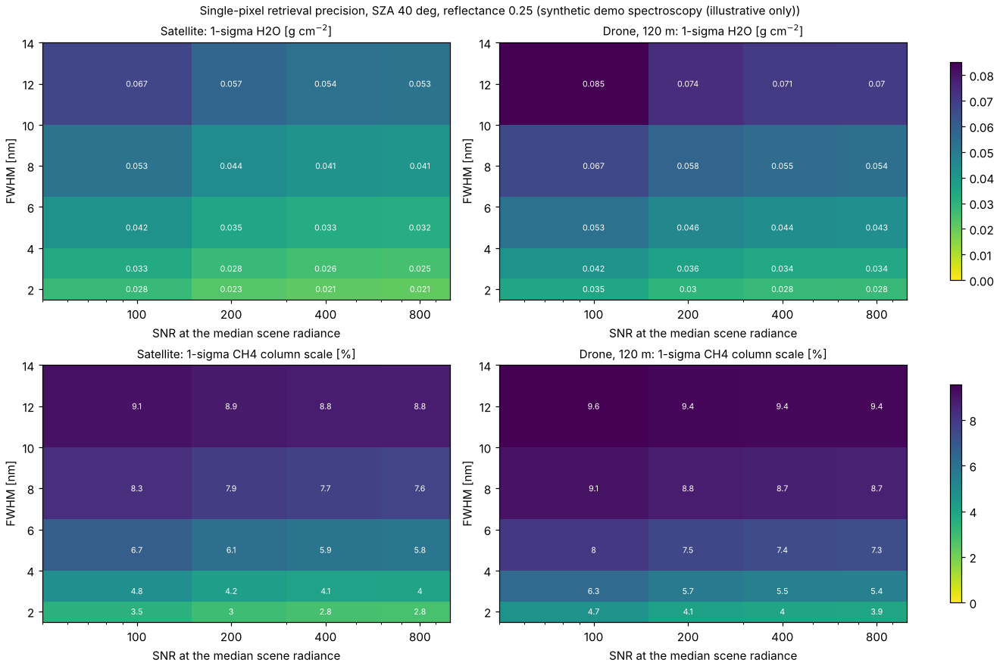
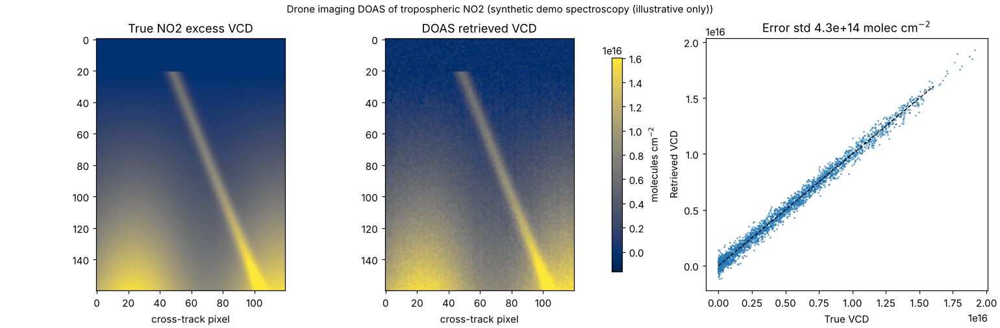

# hyperatmos

**Radiative transfer and atmospheric correction for drone and satellite imaging spectrometers, interoperable with [ISOFIT](https://github.com/isofit/isofit).**

[](https://github.com/naikp13/hyperatmos/actions/workflows/ci.yml)


hyperatmos models how sunlight passes through the atmosphere to an imaging spectrometer, and inverts that model to recover the surface and the atmosphere. It is written for the cases that general atmospheric correction codes handle least well: **low-flying drones**, where the sensor sits inside the atmosphere, and **instrument design**, where you want to know what a camera can retrieve before building it. It needs no licensed radiative transfer code, and it reads and writes ISOFIT's file formats so the two can be chained or compared.

| | ISOFIT | hyperatmos |
|---|---|---|
| Inversion | Full optimal estimation with lookup tables from MODTRAN, 6S, libRadtran or sRTMnet | Fast analytical radiative transfer, image-based correction, and optimal estimation |
| Platform geometry | Mainly airborne and spaceborne | Satellite and **drone**: the upward path, path radiance and gas absorption include only the air below the sensor |
| Speed | Rigorous, per-pixel iterative | Lookup-table correction of a full cube in seconds |
| Design studies | No | Retrieval precision vs FWHM, SNR, spectral window and altitude |
| Shared formats | | Reads and writes `*_rfl`, `*_state` (`H2OSTR`, `AOT550`) and wavelength files |

## What is inside

- **Spectroscopy** (`hyperatmos.spectroscopy`): Voigt line-by-line absorption for H2O, O2, CO2 and CH4 from HITRAN `.par` line lists, plus cross-section absorbers (O3, NO2, SO2). The layered atmosphere is integrated into a high-resolution optical-depth database that is computed once and cached.
- **Radiative transfer** (`hyperatmos.rtm`): the decoupled equation `ρ_s = T_g [ρ_path + T↓T↑ρ / (1 − Sρ)]`. It includes Rayleigh scattering and aerosol (Ångström law, single-scattering albedo, two-term Henyey–Greenstein phase function). Gas transmittance is convolved with the instrument response, and the geometry handles sun, view, azimuth and sensor altitude.
- **Atmospheric correction** (`hyperatmos.atmcorr`): aerosol from dark dense vegetation, per-pixel water vapour from the 0.94 or 1.14 µm band, and algebraic inversion to surface reflectance.
- **Optimal estimation** (`hyperatmos.forward`, `hyperatmos.retrieval`): joint retrieval of water vapour, AOD, optional trace-gas column scales and the reflectance of every band (Rodgers 2000). It reports posterior covariance, averaging kernels and DOFS.
- **Instrument design** (`hyperatmos.design`): linearised retrieval precision for any camera configuration and platform.
- **Trace-gas columns**: DOAS for UV-visible imagers, and a clutter matched filter for absorber anomalies (`hyperatmos.retrieval`).
- **Simulation** (`hyperatmos.simulate`): scenes with known surfaces (vegetation, soil, water, concrete, carbonate) and spatially varying water vapour and aerosol, for closed-loop validation.
- **ISOFIT interoperability** (`hyperatmos.isofit_interop`) and dependency-free ENVI I/O (`hyperatmos.io`).
- A CLI: `hyperatmos build-db | simulate | correct | design`.

## Results on synthetic scenes

> **Read this first.** hitran.org was not reachable from the environment this repository was built in, so the figures and numbers below use hyperatmos's built-in **synthetic demo spectroscopy**. Band positions and depths are realistic, but the fine structure is invented. The figures show the methods and the closed-loop logic. Absolute numbers will change with real line lists; see [Using real spectroscopy](#using-real-spectroscopy).

**1. The radiative transfer components, satellite vs drone** (`examples/01_radiative_transfer.py`)



At 550 nm with AOD 0.2, the path reflectance is 0.048 from orbit and 0.0013 from a drone at 120 m. For a drone, atmospheric correction is mostly a gas-absorption and illumination problem, not a path-radiance problem.

**2. Closed-loop atmospheric correction** (`examples/02_atmospheric_correction.py`)



| Case | AOD (true 0.15) | H2O error (bias / std) | Reflectance RMSE (median / worst band) |
|---|---|---|---|
| EMIT-like satellite, AOD estimated from the image | 0.17 | −0.003 / 0.020 g cm⁻² | 0.0008 / 0.0077 |
| VNIR drone camera at 120 m, AOD given | 0.15 | −0.002 / 0.024 g cm⁻² | 0.0002 / 0.0028 |

**3. Optimal estimation with an error budget** (`examples/03_optimal_estimation.py`)



Per-pixel retrievals of H2O, AOD and every reflectance band come with posterior uncertainties. On 49 pixels the actual errors are smaller than reported (normalised error std 0.29 for H2O, 0.62 for reflectance), so the uncertainties are conservative. A single pixel constrains AOD only weakly (DOFS for H2O and AOD together: 1.4).

**4. Instrument trade study** (`examples/04_instrument_trade_study.py`)



The study maps single-pixel precision of water vapour and of a CH4 column against FWHM and SNR for a satellite and a drone. Precision improves with both narrower bands and higher SNR, because narrow bands separate gas absorption from smooth surface reflectance. SNR is held fixed per band; in a real camera a narrower FWHM lowers SNR, so compare along lines of equal throughput.

**5. Trace-gas columns with a UV-visible imager** (`examples/05_trace_gas_doas.py`)



DOAS mapping of tropospheric NO2 from a drone. The vertical column error is 4.3 × 10¹⁴ molec cm⁻², which matches the reported uncertainty, with no measurable bias.

## Quick start

```bash
git clone https://github.com/naikp13/hyperatmos && cd hyperatmos
pip install -e ".[dev]"
pytest -q                                   # 31 tests, about 10 s
cd examples && python 02_atmospheric_correction.py
```

```python
from hyperatmos import (AtmosphericCorrection, Geometry, RadiativeTransferModel,
                        SpectralDatabase, preset, standard_atmosphere)

db = SpectralDatabase.build(standard_atmosphere(), (380, 2500))      # pass HITRAN line lists for science
rtm = RadiativeTransferModel(db, preset("EMIT"), Geometry(solar_zenith_deg=35, view_zenith_deg=5))
result = AtmosphericCorrection(rtm).correct(radiance_cube)          # AOD and H2O estimated from the image
result.reflectance, result.h2o_g_cm2, result.aod550
```

For a drone, set the sensor altitude: `Geometry(35, 5, 30, sensor_altitude_m=120)`.

### Command line

```bash
hyperatmos build-db --out db.npz --hitran H2O=h2o.par O2=o2.par CO2=co2.par CH4=ch4.par
hyperatmos simulate --db db.npz --sensor EMIT --out scene
hyperatmos correct scene_rdn --db db.npz --sza 35 --out scene          # writes scene_rfl and scene_state
hyperatmos design --db db.npz --altitude 120 --quantity H2O --fwhm-grid 2 5 10 --snr-grid 100 300
```

## Using real spectroscopy

Download HITRAN line lists from [hitran.org](https://hitran.org/lbl/), or use `pip install hitran-api`:

```python
from hyperatmos.spectroscopy import fetch_hitran, read_hitran_par, SpectralDatabase, CrossSectionTable
paths = {g: fetch_hitran(g, 4000, 26300, "hitran") for g in ("H2O", "O2", "CO2", "CH4")}
lines = {g: read_hitran_par(p, g) for g, p in paths.items()}
o3 = CrossSectionTable.from_ascii("o3_serdyuchenko.txt", "O3")
db = SpectralDatabase.build(atmosphere, (380, 2500), linelists=lines, cross_sections={"O3": o3})
db.save("db_hitran.npz")
```

Pass a measured solar spectrum (for example the one ISOFIT ships) as `RadiativeTransferModel(..., solar_irradiance=...)`; the default is a smooth blackbody.

## Using it with ISOFIT

- **Same instrument:** `Instrument.from_isofit_wavelength_file("wavelengths.txt")`.
- **Fast first pass, or a comparison:** `hyperatmos correct` writes `*_rfl` and `*_state` in ISOFIT's layout. `compare_reflectance` reports per-band bias and RMSE against an ISOFIT run.
- **Consistent atmosphere:** `atmosphere_from_isofit(atm, H2OSTR)` rebuilds gas transmittances for ISOFIT's retrieved water vapour.
- **Surface priors:** `surface_prior_from_reflectance(rfl_cube)` turns ISOFIT or hyperatmos reflectance into a Gaussian prior for the optimal-estimation retrieval.
- **Drone flights:** hyperatmos handles sensor altitudes where ISOFIT's lookup tables would need regenerating for each flight height.

## Approximations and roadmap

The scattering part is single-scattering plus a two-stream spherical albedo. It is accurate to a few percent of path reflectance in the red and NIR at moderate AOD, and less accurate in the blue and under heavy aerosol. [docs/methods.md](docs/methods.md) lists every approximation.

Planned:
- Read lookup tables from libRadtran, 6S or ISOFIT's sRTMnet for the scattering terms, keeping hyperatmos's geometry and gas handling.
- Add adjacency effects and topography (slope and aspect, terrain illumination).
- Validate against ISOFIT and in-situ reflectance on public EMIT and AVIRIS-NG scenes, using HITRAN2020 spectroscopy.
- Use scattering air-mass factors for UV-visible trace gases.
- Correct multi-angle drone flights jointly for aerosol and BRDF.

## References

- Rodgers, C. D. (2000). *Inverse Methods for Atmospheric Sounding*. World Scientific.
- Thompson, D. R., et al. (2018). Optimal estimation for imaging spectrometer atmospheric correction. *Remote Sensing of Environment*, 216, 355–373.
- Gao, B.-C., Heidebrecht, K. B., and Goetz, A. F. H. (1993). Derivation of scaled surface reflectances from AVIRIS data. *Remote Sensing of Environment*, 44, 165–178.
- Kaufman, Y. J., et al. (1997). The MODIS 2.1-µm channel: correlation with visible reflectance for use in remote sensing of aerosol. *IEEE TGRS*, 35(5), 1286–1298.
- Hansen, J. E., and Travis, L. D. (1974). Light scattering in planetary atmospheres. *Space Science Reviews*, 16, 527–610.
- Vermote, E. F., et al. (1997). Second simulation of the satellite signal in the solar spectrum, 6S: an overview. *IEEE TGRS*, 35(3), 675–686.
- Platt, U., and Stutz, J. (2008). *Differential Optical Absorption Spectroscopy*. Springer.
- Thompson, D. R., et al. (2015). Real-time remote detection and measurement for airborne imaging spectroscopy: a case study with methane. *Atmos. Meas. Tech.*, 8, 4383–4397.
- Gordon, I. E., et al. (2022). The HITRAN2020 molecular spectroscopic database. *JQSRT*, 277, 107949.

## License

Apache-2.0, the same as ISOFIT.
