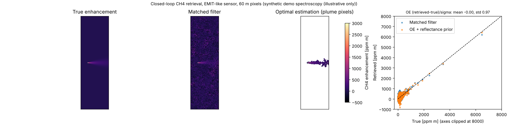
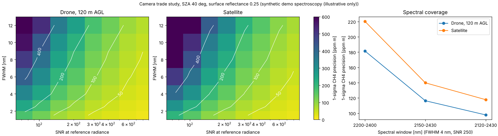
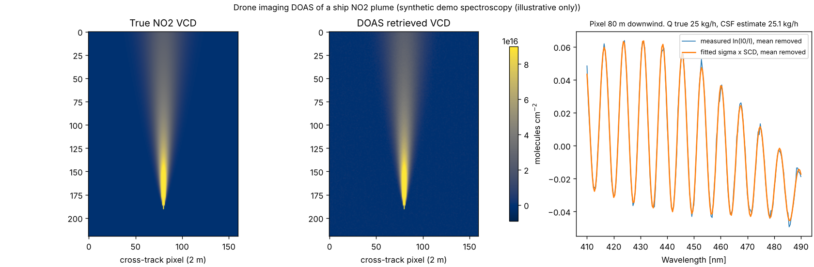

# plumefit

**Trace-gas plume retrievals for drone and satellite imaging spectrometers, designed to work alongside [ISOFIT](https://github.com/isofit/isofit).**

[](https://github.com/naikp13/plumefit/actions/workflows/ci.yml)


ISOFIT inverts imaging spectrometer radiance for surface reflectance, aerosol and water vapour by optimal estimation, treating CH4 and CO2 as fixed background absorbers. plumefit starts where ISOFIT stops. It retrieves **column enhancements of CH4, CO2, H2O, NO2 and SO2** in plumes, reports their uncertainties, and turns them into **emission rates**. ISOFIT's reflectance, water vapour and wavelength files feed straight into it.

| | ISOFIT | plumefit |
|---|---|---|
| Target | Surface reflectance, AOD, H2O | Gas plume enhancements and emission rates |
| Inversion | Optimal estimation of the full spectrum | Matched filter, optimal estimation of the gas window, DOAS |
| Gases | Background only | CH4, CO2, H2O (SWIR); NO2, SO2 (UV-VIS) |
| Platforms | Airborne, spaceborne | Satellite **and drone**: the upward path is only the air below the sensor |
| Shared inputs | | ISOFIT `_rfl`, `_state` (H2OSTR) and wavelength files |

## What is inside

- **Spectroscopy** (`plumefit.spectroscopy`): Voigt line-by-line cross sections from HITRAN `.par` line lists, layered over a hydrostatic atmosphere. Results go into a high-resolution database that is computed once and cached.
- **Forward model** (`plumefit.forward`): at-sensor radiance with analytic Jacobians, Gaussian instrument response and a satellite or drone geometry. The surface is either a reflectance polynomial or per-band reflectance with a statistical prior.
- **Retrievals** (`plumefit.retrieval`):
  - a column-wise **matched filter** with shrinkage, albedo correction and iterative plume exclusion;
  - per-pixel **optimal estimation** (Rodgers 2000) with posterior covariance, averaging kernel and DOFS;
  - **DOAS** for NO2 and SO2 from UV-visible imagers, with a per-column plume-free reference and the I0 correction.
- **Quantification** (`plumefit.quantify`): plume masking, integrated mass enhancement (IME), cross-sectional flux, U_eff calibration and Monte Carlo emission-rate uncertainty.
- **Simulation** (`plumefit.simulate`): Gaussian plumes over heterogeneous surfaces with clay and carbonate features, for closed-loop validation.
- **Camera design** (`plumefit.design`): single-pixel detection precision as a function of FWHM, SNR, spectral window and flight altitude.
- **ISOFIT bridge** (`plumefit.isofit_bridge`) and dependency-free ENVI I/O (`plumefit.io`).
- A CLI: `plumefit build-db | simulate | mf | design`.

## Results on synthetic scenes

> **Read this first.** hitran.org was not reachable from the environment this repository was built in, so the figures and numbers below use plumefit's built-in **synthetic demo spectroscopy**. Its band positions and depths are realistic, but its fine structure is invented. The algorithms and the closed-loop logic are what these results show. Absolute sensitivities will change with real line lists; see [Using real spectroscopy](#using-real-spectroscopy).

**1. Closed-loop CH4 retrieval, EMIT-like sensor** (`examples/01_closed_loop_ch4.py`)



The matched filter detects the plume against 185 ppm·m background noise. Optimal estimation with a surface prior recovers the plume mass to within 0.1% inside the mask, and its normalised errors have mean 0.00 and standard deviation 0.97, so the reported uncertainties are calibrated.

**2. Camera trade study, drone at 120 m vs satellite** (`examples/02_camera_trade_study.py`)



The study maps how spectral resolution, SNR and spectral coverage set CH4 precision. A low-flying drone gains because the upward path crosses only the air below it. Each case holds SNR fixed per band. In a real camera, a narrower FWHM lowers SNR, so compare designs along lines of equal throughput.

**3. Drone imaging DOAS of a ship NO2 plume** (`examples/03_ship_no2_doas.py`)



The camera is a UV-visible push-broom at 100 m with 2 m pixels. Each column uses its upwind lines as the plume-free reference. The true emission is 25 kg/h of NO2, and the cross-sectional flux estimate is 25.1 kg/h.

**4. From ISOFIT products to an unbiased retrieval** (`examples/04_isofit_handoff.py`)

| Surface treatment in OE | Retrieved / true CH4 mass |
|---|---|
| Quadratic reflectance only | 1.50 (clays and carbonates read as CH4) |
| Raw ISOFIT reflectance as a fixed surface | 0.00 (the plume is already in it) |
| Nearest plume-free pixel's reflectance | −1.36 (the surface changes under the plume) |
| **Joint gas + per-band reflectance, prior from plume-free ISOFIT reflectance** | **0.93** |

ISOFIT does not model the plume, so inside it the ISOFIT reflectance is dented at the CH4 bands. In the joint retrieval, the mean and covariance of plume-free ISOFIT reflectance constrain the surface, and the gas is separated from surface features. Its reported uncertainty is conservative for now (normalised error std 0.15), because one scene-wide Gaussian is broader than the local surface variability.

## Quick start

```bash
git clone https://github.com/naikp13/plumefit && cd plumefit
pip install -e ".[dev]"
pytest -q                                  # 32 tests, about 25 s
cd examples && python 01_closed_loop_ch4.py
```

```python
from plumefit import ForwardModel, Geometry, SpectralDatabase, preset, standard_atmosphere
from plumefit.retrieval import OptimalEstimation, matched_filter

db = SpectralDatabase.build(standard_atmosphere(), (2100, 2450))   # pass HITRAN line lists for science
fm = ForwardModel(db, preset("EMIT"), Geometry(solar_zenith_deg=35, view_zenith_deg=5))

mf = matched_filter(radiance_cube, fm.unit_absorption_spectrum("CH4"))   # ppm·m map + 1-sigma
res = OptimalEstimation(fm).retrieve(radiance_cube[r, c])
res.enhancement("CH4"), res.uncertainty("CH4"), res.dofs
```

For a drone, set the sensor altitude: `Geometry(40, 0, sensor_altitude_m=120)`.

### Command line

```bash
plumefit build-db --out db.npz --wl 2100 2450 --hitran CH4=ch4.par H2O=h2o.par CO2=co2.par
plumefit simulate --db db.npz --sensor EMIT --q 1500 --out scene
plumefit mf scene_rdn --db db.npz --sza 35 --out scene_ch4
plumefit design --db db.npz --altitude 120 --fwhm-grid 2 4 8 --snr-grid 100 200 400
```

## Using real spectroscopy

Download HITRAN line lists for the window (about 4000–4800 cm⁻¹ for 2.1–2.45 µm) from [hitran.org](https://hitran.org/lbl/), or with `pip install hitran-api`:

```python
from plumefit.spectroscopy import fetch_hitran, read_hitran_par, SpectralDatabase
paths = {g: fetch_hitran(g, 4000, 4800, "hitran") for g in ("CH4", "CO2", "H2O")}
lines = {g: read_hitran_par(p, g) for g, p in paths.items()}
db = SpectralDatabase.build(atmosphere, (2100, 2450), linelists=lines)
db.save("db_hitran.npz")
```

Then rerun the examples with that database. For NO2 and SO2, load measured cross sections (for example Vandaele et al. for NO2, Bogumil et al. for SO2) with `CrossSectionTable.from_ascii`.

## Using it with ISOFIT

1. Run ISOFIT (`apply_oe`) on the flight line to get `*_rfl` and `*_state`.
2. Read them with `read_isofit_reflectance` and `read_isofit_state`. Set background water vapour with `scale_atmosphere_h2o(atm, H2OSTR)`. Build the instrument with `Instrument.from_isofit_wavelength_file`.
3. Run the matched filter on the radiance to find plume pixels.
4. Estimate the surface prior from plume-free reflectance with `surface_prior_from_reflectance(rfl, plume_mask)`. Run `OptimalEstimation(ForwardModel(..., surface="bands"), surface_prior=...)` on the plume pixels.
5. Quantify with IME (after calibrating U_eff for your sensor) or cross-sectional flux.

## Roadmap

- Validate against public EMIT and AVIRIS-NG plume products with HITRAN2020 spectroscopy.
- Use a local, brightness-normalised surface prior so the joint retrieval's uncertainty is calibrated as well as unbiased.
- Multi-angle and tomographic reconstruction of plume height and 3-D structure from drone overpasses.
- Add aerosol scattering through ISOFIT's radiative transfer (sRTMnet or 6S lookup tables) instead of the non-scattering approximation.
- Compute UV-visible air-mass factors with a scattering model for elevated plumes.
- Calibrate U_eff with large-eddy simulations for specific sensors and pixel sizes.

## Method notes and references

The equations are in [docs/methods.md](docs/methods.md). Key references:

- Rodgers, C. D. (2000). *Inverse Methods for Atmospheric Sounding*. World Scientific.
- Thompson, D. R., et al. (2018). Optimal estimation for imaging spectrometer atmospheric correction. *Remote Sensing of Environment*, 216, 355–373.
- Thompson, D. R., et al. (2015). Real-time remote detection and measurement for airborne imaging spectroscopy: a case study with methane. *Atmos. Meas. Tech.*, 8, 4383–4397.
- Foote, M. D., et al. (2020). Fast and accurate retrieval of methane concentration from imaging spectrometer data using sparsity prior. *IEEE TGRS*, 58(9), 6480–6492.
- Frankenberg, C., et al. (2016). Airborne methane remote measurements reveal heavy-tail flux distribution in Four Corners region. *PNAS*, 113(35), 9734–9739.
- Varon, D. J., et al. (2018). Quantifying methane point sources from fine-scale satellite observations of atmospheric methane plumes. *Atmos. Meas. Tech.*, 11, 5673–5686.
- Platt, U., and Stutz, J. (2008). *Differential Optical Absorption Spectroscopy*. Springer.
- Aliwell, S. R., et al. (2002). Analysis for BrO in zenith-sky spectra: an intercomparison exercise. *J. Geophys. Res.*, 107(D14).
- Gordon, I. E., et al. (2022). The HITRAN2020 molecular spectroscopic database. *JQSRT*, 277, 107949.

## License

Apache-2.0, the same as ISOFIT.
